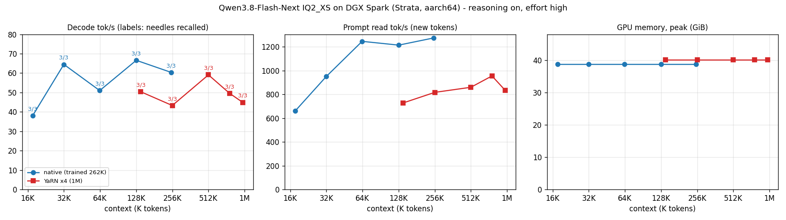

# Strata on NVIDIA DGX Spark (aarch64): results

Qwen3.8-Flash-Next IQ2_XS (64 GiB), branch `sparky/aarch64-port`, measured 2026-10-14.
DGX Spark: GB10, 128 GB unified memory, 20 Arm cores, CUDA 13.0.
Every run: reasoning on (effort high), greedy, MTP drafts on, all 24576 experts resident on
the GPU (`--expert-cache 24576 --mmap-experts`), KV int8, 70 GiB memory cap.

## Context ladder: speed, recall and GPU memory

Each step: a filler document with 3 facts placed at 2%, 50% and 97% of its length, then one
question for all 3. Raw rows: `RESULTS-aarch64-context-ladder.jsonl`.

| Context | Mode | Recall | Decode tok/s | Prompt read tok/s | GPU peak | Wall time |
|---|---|---|---|---|---|---|
| 18K | native | 3/3 | 38 | 660 | 38.7 GiB | 0.5 min |
| 32K | native | 3/3 | 64 | 950 | 38.7 GiB | 0.6 min |
| 64K | native | 3/3 | 51 | 1246 | 38.7 GiB | 0.9 min |
| 128K | native | 3/3 | 67 | 1214 | 38.7 GiB | 1.8 min |
| 250K | native | 3/3 | 60 | 1274 | 38.7 GiB | 3.3 min |
| 140K | YaRN x4 | 3/3 | 50 | 728 | 40.1 GiB | 3.2 min |
| 256K | YaRN x4 | 3/3 | 43 | 816 | 40.1 GiB | 5.3 min |
| 512K | YaRN x4 | 3/3 | 59 | 859 | 40.1 GiB | 10.0 min |
| 768K | YaRN x4 | 3/3 | 50 | 955 | 40.1 GiB | 13.5 min |
| 989K | YaRN x4 | 3/3 | 45 | 834 | 40.1 GiB | 19.8 min |

- Recall holds at 3/3 up to 989K tokens.
- Decode stays at 43-67 tok/s with no fall-off as the context grows. Each step generated only
  80-200 tokens, so single values are noisy.
- At equal length, YaRN x4 decodes about 25% slower and reads prompts about 40% slower.
- GPU memory is almost flat: the KV cache streams from RAM, and 88-92% of KV reads still hit
  the GPU.

Native: `--max-context 262144`. YaRN x4: `--max-context 1048576 --rope-scaling yarn
--rope-scale 4 --yarn-orig-ctx 262144`.

## Short-prompt speed (2000 tokens generated)

Native, one request: median **50.4 tok/s** decode (41.5-52.2, 3 runs), 75% draft acceptance.

## YaRN x4 quality on short prompts

Six prompts (code, math, fact, reasoning, Chinese, chat), 48 greedy tokens each, YaRN x4 against
native:

| Prompt | Identical tokens | Note |
|---|---|---|
| code, math, fact | 48/48 | identical |
| reasoning | 47/48 | one newline differs |
| Chinese | 9/48 | different wording, both answers correct |
| chat | 5/48 | "a name suggestion" vs "name suggestions", same plan |

No answer became wrong. A per-token KL measure was not possible: this engine mode wrote no
logits for the scored prompt.

## Limits

- One machine, one pack, one run per context step.
- The needle test checks retrieval only, not long-context reasoning.
- A 50 GiB cap with a partial expert cache ran at about 5 tok/s total: on this machine, keep
  every expert on the GPU.
